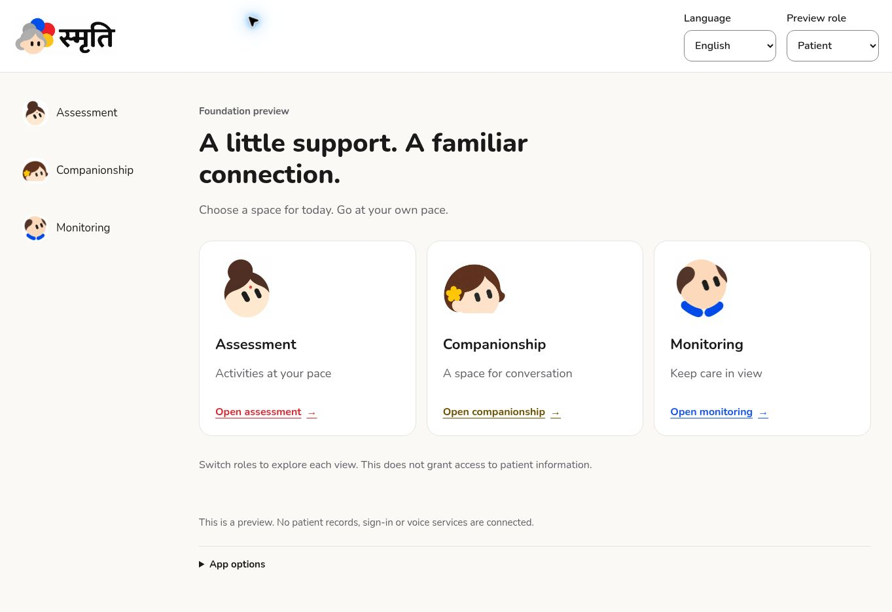
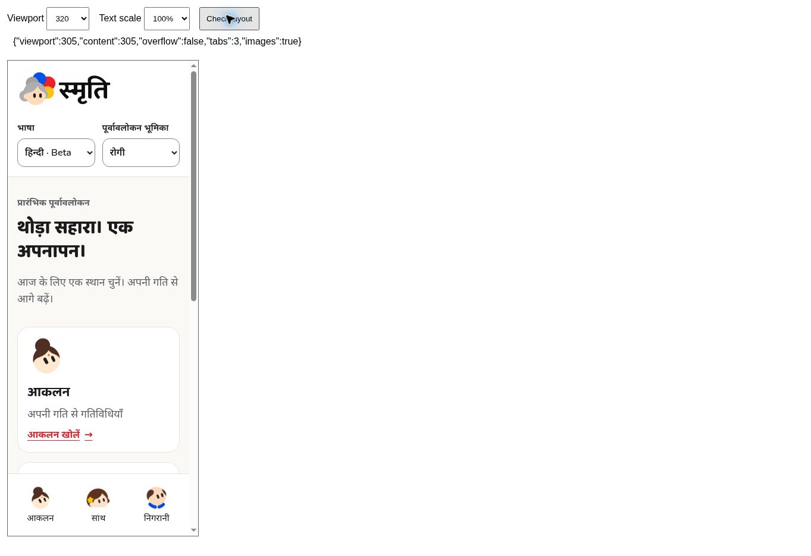

# Phase 1 — Implementation delivered; device acceptance pending

Date: 2026-11-02. Target: AnujDubeyy/Smriti only. No production deployment or Cybrion Consulting changes.

## Deliverables

- [x] Next.js, strict TypeScript and Tailwind foundation.
- [x] Canonical palette, supplied logo/mascots, self-hosted script-specific fonts and licenses.
- [x] Shared AppShell, PillarNav and labelled locale/role controls.
- [x] Exactly three tabs: Assessment → Companionship → Monitoring; bottom mobile navigation and desktop sidebar.
- [x] Patient, caregiver and clinician preview content with honest disabled states. No permission grant implied.
- [x] English/Hindi/Marathi dictionaries throughout the UI and offline shell; Hindi/Marathi beta labels.
- [x] PWA manifest, 192/512 icons, install-event handling, public offline shell and cache versioning.
- [x] Loading/error/retry/not-found components, offline notice, skip link, route focus, reduced motion and safe-area CSS.
- [x] Regression tests, architecture/privacy notes, asset provenance and screenshot evidence.

## Commands and outcomes

Run in apps/web:

- `npm test`: 8 tests pass, 0 failures. Covers complete locales, disabled capabilities, credential-free public precache, offline fallback, API/auth/cross-origin/method exclusions, RSC/query exclusions, isolated cache cleanup and non-persistence of online HTML.
- `npm run lint`: exit 0.
- `npm run typecheck`: exit 0.
- `npm run build`: exit 0, including TypeScript and generation of home, all three pillar routes, not-found and manifest.

An intermediate rebuild hit a Turbopack persistence-cache error; clearing only generated .next output fixed it.

## Browser evidence

Tested the built production application in managed Chrome. Development-preview controls did not hydrate reliably; that mode is not claimed as verified. Production preview passed these observed interactions:

- Navigated all three pillars; active state and heading changed.
- Caregiver choice survived client navigation; clinician Monitoring displayed Care review.
- Hindi and Marathi replaced navigation, role text, headings, descriptions, actions and footer. Hindi offline-shell switching worked.
- Skip link focused main; activating Assessment by keyboard focused its heading.
- Unknown route rendered the not-found UI. The standalone offline shell rendered without patient data.
- Image review caught clipped source-SVG mascots; display copies now use the supplied complete raster references, preserving aspect ratio. Original sources are retained.
- Responsive harness checked outer widths 320, 360, 390, 430, 768, 1024, 1280 and 1440. Chrome's scrollbar reduced inner layout widths by 15px. No horizontal overflow at 100% or doubled root text size; all three tabs and images remained present. Hindi at the smallest width and Marathi at doubled text size also fit.
- Fixed initial enlarged-text overflow by stacking narrow cards and allowing text wrapping. Widened the desktop sidebar to fit Companionship.

## Remaining acceptance gates — not claimed complete

1. **Installability and real offline reload:** need HTTPS or eligible localhost. The managed preview is HTTP on terminal.local. Worker logic passed VM tests and the offline page was viewed; actual installed-PWA/offline-reload behavior was not verified.
2. **Device/browser accessibility:** doubled-root-text reflow was tested; actual 200% browser zoom, iOS/Android safe areas, standalone mode and screen-reader behavior still need device acceptance. Keyboard shortcuts did not alter this cloud browser's zoom and are not counted as a pass.
3. **Native language review:** Hindi/Marathi remain beta. No native-speaker, speech or clinical validation is claimed.
4. Loading/error components build successfully; deliberate runtime fault/retry injection was not performed.

The original contract requires installability and browser/device exit tests, so implementation delivery is distinct from full Phase 1 acceptance sign-off. Authentication belongs to Phase 2; clinical and voice capabilities remain disabled.

## Changelog

Added approved assets/fonts and licenses, complete locale dictionaries, responsive role previews, accessibility/state primitives, PWA metadata, privacy-limited offline worker, tests and QA harness, architecture/decision/provenance/evidence documentation. Removed starter branding. No external care services, secrets, production domains or database changes.
