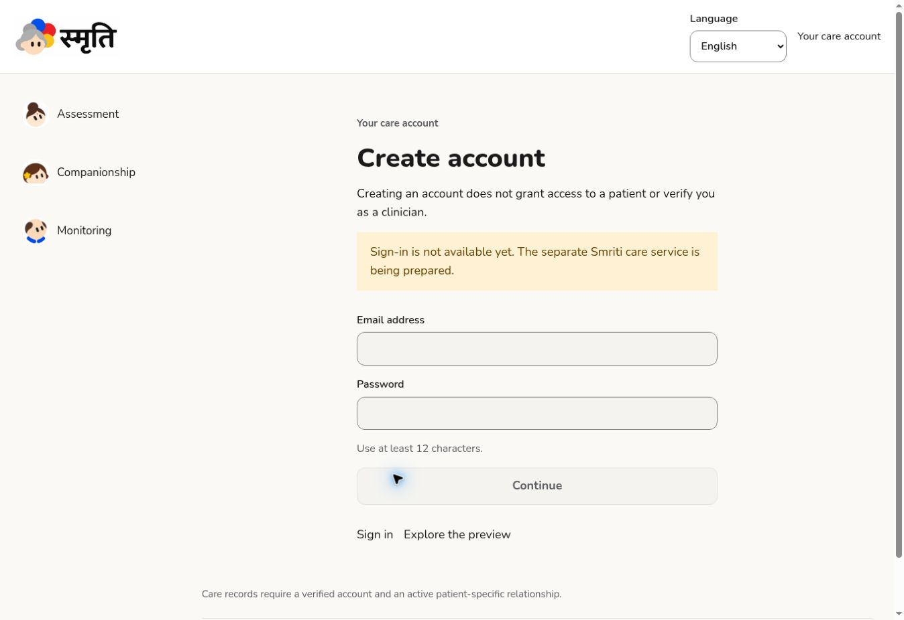

# Phase 2 — Started: identity and authorization foundation

Date: 2 November 2026 (IST). This is the first Phase 2 increment, not phase completion or production approval.

## Implemented

- Server-side Supabase Auth client; sign-in, signup, logout and PKCE callback handlers; session-refresh proxy. Identity is checked with getUser for protected requests, not trusted from a cookie/user metadata object.
- Localized login/signup and patient-selector screens. Signup accepts only email/password; there is no clinician-role selector. Preview role controls are hidden on account routes.
- GET patient-list and patient-detail APIs using the user's RLS-bound client. Missing and unauthorized patient IDs both return 403 after identity validation; no privileged service key is used.
- Explicit separate-project configuration. Missing/mismatched configuration fails closed, and the known Cybrion project reference is rejected. Forms remain disabled while unconfigured.
- A CLI-created migration for app_users, patients, patient_memberships, consent_grants, patient_authorities, account_invitations, clinical_notes and audit_events; explicit SQL grants and RLS on every table.
- Private recording bucket with no client object access or upload policies yet.
- Trusted-only professional verification/membership provisioning. User metadata cannot populate authorization fields. A verified clinician also needs a current patient relationship and active clinician-sharing consent.
- Consent-authority checks independent of caregiver role; consent withdrawal is irreversible through client grants. Mutation audit events exclude note content and patient names.

## Verification

`npm test`: **37 pass, 0 fail**. 24 tests execute the actual migration and policies using PGlite PostgreSQL with synthetic auth/storage schema fixtures, 5 exercise HTTP/configuration boundaries, and the original 8 foundation tests still pass.

Coverage includes cross-patient denial, unverified/suspended clinicians, expired/revoked memberships, withdrawal of clinician-sharing consent, caregiver clinical-note denial even with an erroneous scope, author spoofing, immutable audit writes, blocked self-verification, preference updates, blocked consent fabrication, and private storage default denial.

`npm run lint`, `npm run typecheck` and `npm run build`: pass. Browser smoke checks confirmed login→signup navigation, Hindi localization, hidden preview-role selector on account screens, disabled fields when unconfigured, and a patient-detail URL returning only not_configured without data.

## Boundaries and remaining Phase 2 work

Only the Cybrion Consulting organization and cybrion-training project were visible through the Supabase connector. No schema, auth setting, key, storage bucket, project or billing configuration was changed there. A separate Smriti project and organization choice are required before live configuration.

The PostgreSQL tests are meaningful RLS tests, but do not run GoTrue, PostgREST or the Storage service. No live signup, confirmation email, session refresh/revocation, authenticated browser 403, storage signed URL, or Supabase advisor pass is claimed.

Still pending: invite creation/redemption with token hashing, expiry, concurrency and idempotency; patient onboarding and representative verification workflows; membership management and revocation UI; consent history/grant/withdrawal UI/API; recovery flow; durable rate limiting/captcha decisions; live synthetic seed accounts and complete browser security checks. The current patient selector confirms one authorized selection in memory; it does not yet carry patient context into the three functional care workflows.

Clinical notes/storage tables are authorization foundations, not live clinical products. Real patient data remains prohibited until governance and release gates are met. Phase 1's HTTPS/device acceptance gaps also remain open.

## Sources reviewed

Supabase changelog (retrieved 2 November 2026), current Next.js SSR client documentation, package type declarations, and installed Next.js authentication/proxy/route-handler docs. The April 2026 Data API exposure change is handled with explicit grants; modern Node and TLS are required. No existing database upgrade was attempted.
