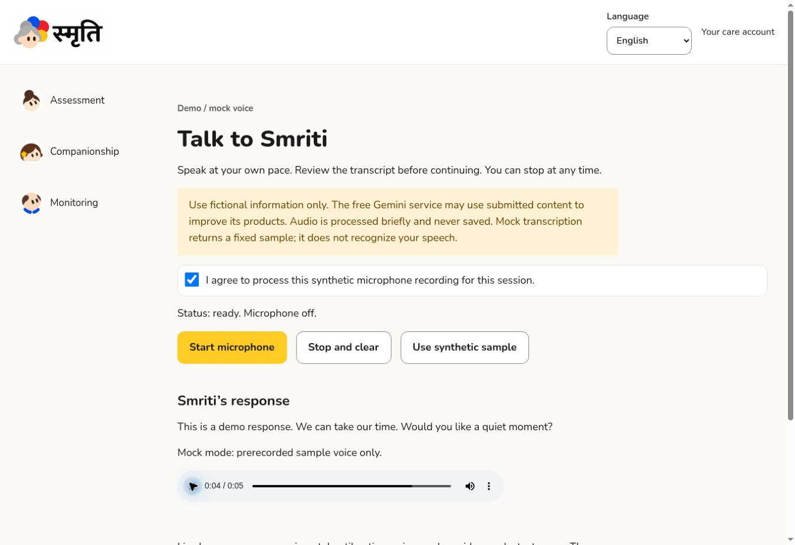

# Phase 3 — speech and Gemini implementation; live acceptance pending

Date: 2 November 2026 (IST).

## Delivered

- Authenticated server-only Prisma STT, Gemini and Timbre TTS adapters; deterministic labelled no-key mocks and a public `/voice` sample.
- Explicit microphone consent, bounded in-memory PCM WAV capture, transcript review/edit before AI, playback controls, stop/clear, locale/unmount/background cleanup and abort signals.
- Server-side membership/consent checks before and after provider stages; initiating-user session ownership; 30-minute session lifetime; durable turn reservation/deduplication and usage limits. Revocation is polled every four seconds in the UI and checked between server stages; already-submitted provider processing cannot be recalled.
- Separate synthetic-profile gate, optional transcript retention, withdrawal scrubbing, no audio persistence and no raw provider-error logging. API errors are generic.
- Gemini structured output, bounded context/history, exact source-ID/quote validation for human logs, approved-context-only personal facts and deterministic stop handling. Outputs remain drafts requiring review.

## Evidence

65 automated tests pass, including malformed/oversized WAV, STT/TTS payload contracts, no-speech/provider failures, incomplete Gemini output, rejected unknown citations/altered quotes, selected unsafe output, request cancellation, deterministic mocks, no-retention, consent withdrawal and duplicate turn claims. These use transport stubs for providers, not live keys.

Browser on the managed HTTP preview: synthetic sample → editable transcript → confirmed mock reply → native audio playback passed. Stop and clear removed reply/audio/transcript with microphone off. The fixture is explicitly labelled prerecorded mock speech. Screenshot:

## Open acceptance gates

No locally stored API keys are available in this environment. Therefore no real Gnani/Gemini request, billable-credit check, end-to-end authenticated browser session, physical microphone, mobile device or native-language voice validation is claimed. HTTP preview cannot provide secure-context microphone acceptance. Run the local checklist before calling Phase 3 accepted.

English, Hindi and Marathi are experimental candidates, not verified speech support promises. The public mock sentence/voice is English. The new workflow UI is primarily English. No medical diagnostic accuracy or hallucination-free behavior is claimed; citation/quote matching checks provenance, not semantic entailment or clinical validity.

Life Book authoring and verified personal-story creation belong to Phase 4. Until approved context exists and both relevant consents are active, the model receives no personal stories. Full Phase 5 companionship/session strategies and later clinical monitoring remain pending.
